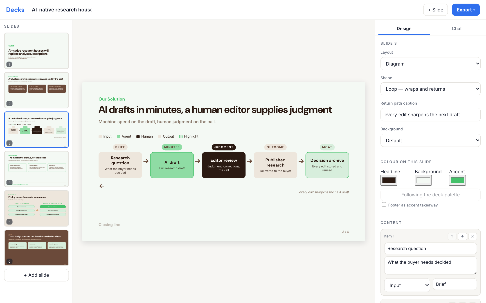
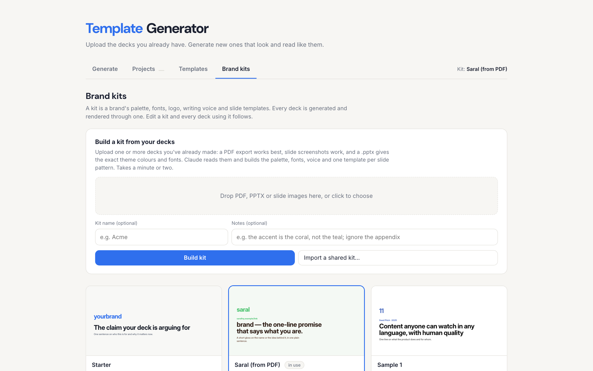
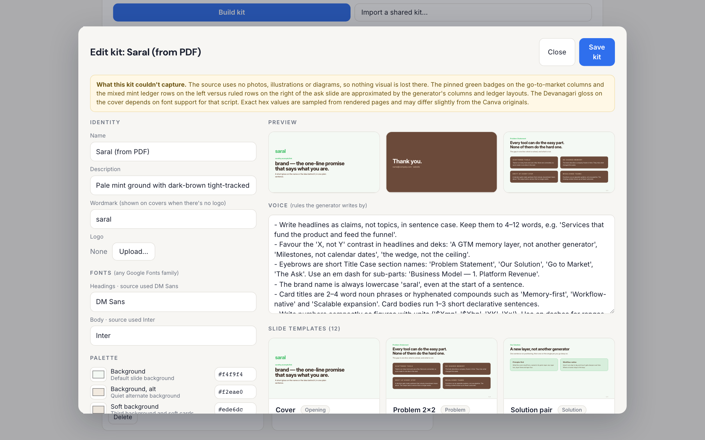
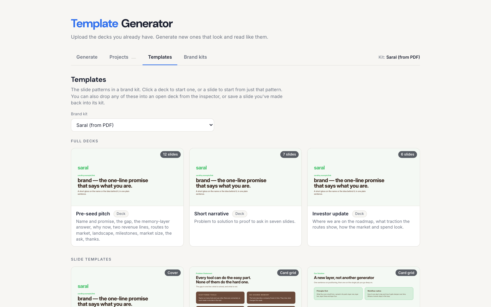

# Template Generator

Upload the decks you already have. Get a brand kit. Generate new decks that look
and read like yours, instead of a stock theme.

It runs on your own computer with your own Anthropic API key. Your decks and kits
stay on your machine.



| Upload decks, get a kit | Check and adjust the kit |
|---|---|
|  |  |

Above: a kit built from one uploaded pitch-deck PDF in about 70 seconds (colours,
fonts, voice and 12 slide templates), then a 6-slide deck generated in it.

---

## How it works

1. **Build a brand kit from your decks.** On the **Brand kits** tab, upload one or
   more decks you've already made:
   - a **PDF export** works best (Claude sees every slide);
   - **slide screenshots** (PNG/JPG) also work;
   - a **.pptx** gives the exact theme colours and fonts, plus each slide's text.

   Claude reads them and builds a kit in a minute or two:
   - **palette:** your colours mapped onto the renderer's roles (background,
     headings, accent, filled card, and so on);
   - **fonts:** your typefaces, or the closest Google Fonts match, downloaded
     and self-hosted;
   - **wordmark:** your brand name as it appears on the cover (upload a logo
     to replace it);
   - **voice:** 6 to 10 concrete writing rules taken from your own copy;
   - **slide templates:** one per distinct pattern in your decks, rebuilt in the
     app's layouts, with placeholder copy (your real numbers, names and contact
     details are never carried over);
   - **deck arcs:** your deck's running order, plus shorter versions of it;
   - **caveats:** a plain list of what the kit couldn't reproduce, such as
     photography, custom illustration, or a layout with no equivalent.

2. **Check and adjust the kit.** The kit editor shows live previews. Change
   any colour, swap fonts (any Google Fonts family), edit the voice rules, upload
   a logo, and remove templates you don't want.

   

3. **Generate.** On **Generate**, pick the kit, paste an outline, notes or a
   full document, and Claude builds the deck. It follows your layouts and your
   voice, and it won't invent numbers you didn't give it.

4. **Edit.** Click any text on a slide to change it. Switch layouts, card styles
   and backgrounds from the inspector, or use the **Chat** tab to describe a
   change ("make slide 4 a stats slide", "tighten every card to one sentence").

5. **Grow the kit.** When you make a slide you like, click **Save slide to the
   kit** and it becomes a template for next time.

6. **Export** to PDF, PNGs (one per slide, 2×), or one standalone HTML file.

7. **Share a kit.** **Share (.zip)** exports the kit with its logo. Someone else
   imports it with **Import a shared kit…** and generates in the same brand.

Every deck remembers its kit. Edit the kit and every deck made with it follows;
a deck's own colour tweaks still sit on top.

---

## Setup

You need Python 3.10+ and an Anthropic API key
([console.anthropic.com](https://console.anthropic.com/)).

```bash
git clone <this repo> template-generator
cd template-generator
pip install -r requirements.txt
python3 -m playwright install chromium     # used for PDF/PNG export
cp .env.example .env                       # then paste your key into .env
bash start.sh                              # opens http://localhost:5055
```

Or run `python3 app.py`. Set `PORT` in `.env` to use a different port, and
`DECK_MODEL` to choose the Claude model.

**Costs.** Calls go to your own Anthropic account. Building a kit from a deck is
one large request (it reads every page). Generating a deck is one request; each
chat message or slide rewrite is a small one.

---

## The layouts

Every slide is one of fifteen layouts. Kits restyle them; they don't add new ones.

| Layout | For |
|---|---|
| `cover` | opening slide: logo or wordmark, claim, one line underneath |
| `section` | a divider, or a full-bleed statement on a dark background |
| `statement` | one centred sentence |
| `quote` | a verbatim quote with attribution |
| `cards` | 2–6 parallel points |
| `columns` | bulleted columns, each with an optional stat badge |
| `numbered` | numbered themes, each with its own cards |
| `flow` | 3 stages joined by arrows |
| `stats` | 2–4 headline numbers |
| `pillrows` | term → definition rows |
| `mapping` | two pill columns joined by an arrow |
| `cycle` | six steps in a closed loop |
| `ledger` | two columns of line items with amounts |
| `diagram` | a workflow of typed nodes, in a line or a loop |
| `bullets` | a plain list |

Card styles: filled, tinted, tinted (alternate), soft, outline. Backgrounds:
default, alternate, soft, dark, darkest.

---

## What it can't do

- Place photos or illustrations from your decks. You can add one image per cover
  slide by hand.
- Reproduce a slide layout that none of the fifteen layouts can express. The kit
  maps it to the nearest one and says so under caveats.
- Use commercial fonts. It picks the closest free Google Fonts family.
- Run as a hosted, multi-user website. It's a local app with no logins.

---

## Files

```
app.py              Flask routes: decks, kits, export
kits.py             kit storage, palette roles, import/export, logo handling
extract.py          uploaded decks → kit (Claude, structured output)
generate.py         brief → deck JSON in a kit's voice (Claude, structured output)
chat.py             the editing chat and its tools
fonts.py            installs Google Fonts locally on demand
export.py           Playwright → PDF / PNG / standalone HTML
static/css/theme.css   base design tokens (kits override these)
static/js/layouts.js   deck JSON → HTML, shared by editor, previews and export
static/js/editor.js    editor, home tabs
static/js/kits.js      kit picker, upload, kit editor
kits/starter/       the built-in kit; your kits live alongside it
decks/              your decks, one JSON file each
```

Decks and kits are plain JSON, so you can read, diff and hand-edit them.
`decks/`, your own kits and `.env` are git-ignored.

---

## Licence

MIT. See [LICENSE](LICENSE). The bundled DM Sans and Inter fonts are under the SIL Open Font License.
